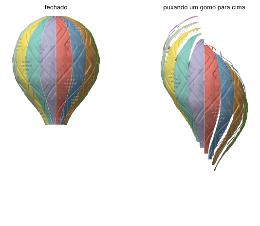

# Modelos 3D

Modelos em STL para imprimir em impressora 3D. Cada modelo tem um script gerador em `modelos/<nome>/` e os STLs prontos em `stl/<nome>/`.

## Balão sensorial de gomos (`modelos/balao`)

Brinquedo para crianças com autismo (3 anos ou mais). O balão tem 12 cm de diâmetro e 15 cm de altura, é feito de **16 gomos** e se desmonta em escada quando a criança puxa um gomo para cima, como as folhas da foto de referência. Nenhum gomo se solta. Ele fica independente do suporte (base + cesta + hastes + aro) e é só apoiado no aro.



*(As cores da imagem só separam os gomos. O STL é de uma peça só.)*

| Peça | Arquivo | Tamanho (mm) | Observação |
|---|---|---|---|
| Balão com 16 gomos | `stl/balao/balao_16_gomos.stl` | 120 x 120 x 150 | impresso já montado (print-in-place), 20 MB |
| Suporte | `stl/balao/suporte.stl` | 130 x 130 x 108 | base larga, cesta trançada, 4 hastes e aro com assento cônico |

### Como funciona

- Cada gomo é uma casca de 2 mm de parede, com 0,5 mm de folga em relação aos vizinhos.
- Dois gomos vizinhos são ligados por uma junta de **pino e olhal**: o olhal desliza no pino 16 mm no total (±8 mm), parando nas cabeças do pino. Isso dá o efeito de escada.
- A corrente tem 15 juntas. Entre o gomo 15 e o gomo 0 não há junta, então a corrente é aberta e os gomos nunca ficam presos em círculo.
- Na verificação por computador, nenhum par de gomos colide no repouso nem nas posições abertas. Só há contato nos batentes, que é o que se quer.

### Desenho e texturas

Os losangos seguem o logo: grade escalonada, com uma moldura e um losango menor dentro. Cada losango interno tem uma de 4 texturas, que se alternam em diagonal:

1. liso e alto
2. pontos
3. listras
4. afundado

Dá para pintar cada textura de uma cor com tinta acrílica não tóxica. O relevo vai de -0,6 a +1,4 mm.

### Impressão

- PLA ou PETG, bico 0,4 mm, camada de 0,2 mm, **sem suporte**, sem brim nas juntas.
- O balão é print-in-place: as folgas são de 0,4 a 0,5 mm. Se os gomos saírem colados, gire-os com a mão e aplique força leve até soltar. Em impressoras muito frouxas pode ser preciso ajustar a calibração de fluxo.
- Pino e olhal imprimem sem suporte, com escoras a 45°.
- Suporte com 100% de preenchimento na base e no aro. A altura total do suporte é 108 mm e a do balão é 150 mm, então tudo cabe em 250 mm de altura de impressão.
- O balão usa cerca de 147 cm³ de PLA e o suporte cerca de 120 cm³ no modelo cheio.
- Lixe as bordas e a ponta das hastes antes de entregar.

### Segurança

Foi verificado só no computador (peças fechadas, sem colisão, balão assentado no aro e estável até cerca de 2° de inclinação). **Nada foi impresso nem testado.** Faça um teste de giro e de puxar antes de dar a uma criança. Use sempre com a supervisão de um adulto: o brinquedo não é certificado. Há pequenos vãos nas juntas onde um dedo fino pode ficar preso; confira se o tamanho do vão é adequado à idade.

### Regerar com outras medidas

```
pip install numpy scipy trimesh manifold3d networkx
python3 modelos/balao/gerar_balao.py --diametro 120
```
